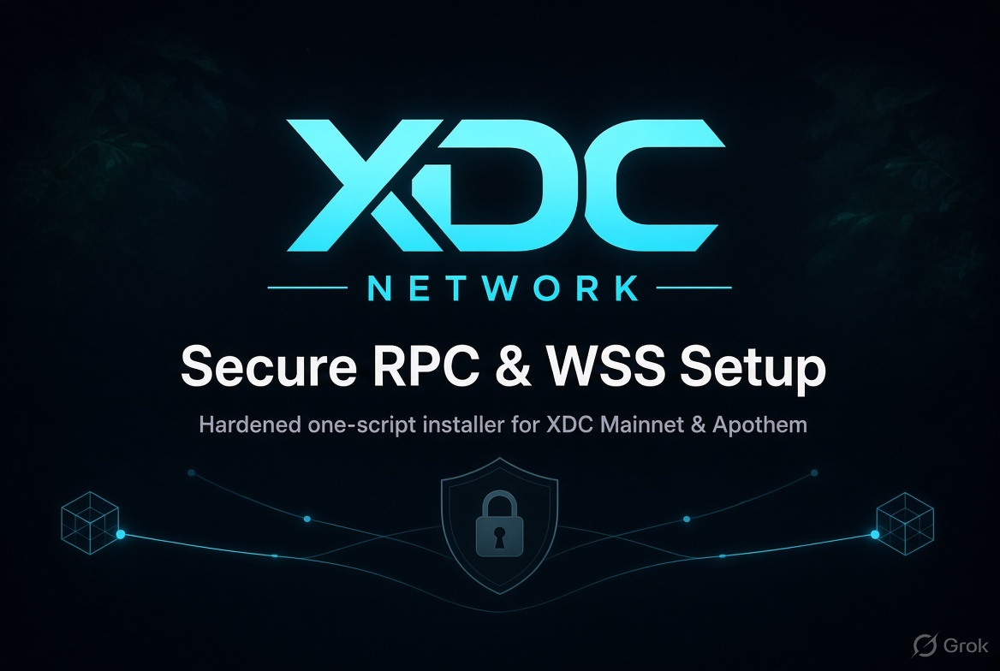

> **Test copy** of XDC Secure RPC & WSS, for checking a release before it goes live. Not for real nodes.

<p align="center">
  
</p>

# XDC Secure RPC & WSS

Run an XDC node with private RPC and WebSocket endpoints that only the IP addresses you choose can use. For any XDC node operator, including Plugin RPCaaS operators.

One command installs it. After that, `sudo xdc-rpc` opens a menu for everything else: who can use your endpoints, SSH safety, backups and updates.

**Full guide:** [xdcoutpost.xyz/XDC-Secure-RPC-WSS-test](https://xdcoutpost.xyz/XDC-Secure-RPC-WSS-test/) · Part of [XDC Outpost](https://xdcoutpost.xyz/?utm_source=github-rpc-wss)

**What you get**

- RPC: `https://your.domain/xdcrpc`
- WSS: `wss://your.domain/xdcwss`
- An XDC Mainnet or Apothem testnet node, full or archive
- Only the addresses on your allowlist can connect. The firewall and the web server both check.
- A Let's Encrypt certificate that renews itself. Port 80 stays closed except for the minute or so a renewal takes.
- Optional: Plugin's RPCaaS gateway allowed with one answer, and kept up to date for you
- Encrypted backups, and a restore that rebuilds the node on a new server

---

## Before you start

- **A server** running Ubuntu 24.04 or 26.04 LTS, with root or sudo access. For a full node: 6+ CPU cores, 16 GB RAM or more (32 GB for a busy endpoint) and a 2 TB+ SSD (1.5 TB is enough if you sync from scratch instead of using a snapshot). An archive node needs several times more disk.
- **A domain name** for the endpoints, such as `rpc.example.com`, with an **A record** pointing to the server's IP address.
  - Don't add an AAAA (IPv6) record: the endpoints work over IPv4.
  - If your DNS is at Cloudflare, set the record to **DNS only** (grey cloud).
- **Open ports**, if your VPS provider has a firewall in its control panel:

  | Port | Why |
  |---|---|
  | 443 TCP | Your RPC and WSS endpoints |
  | 80 TCP | Certificate renewals (closed on the server itself except during a renewal) |
  | 30303 TCP and UDP | P2P: other XDC nodes connect here. Apothem uses 30312. You can choose another port during setup. |
  | Your SSH port | Usually 22 |

## Install

Log in to your server with SSH, then paste this line and press Enter:

```bash
curl -fsSL --remote-name-all https://github.com/s4njk4n/XDC-Secure-RPC-WSS-test/releases/latest/download/xdc-rpc.sh{,.sha256} && sha256sum -c xdc-rpc.sh.sha256 && sudo bash xdc-rpc.sh
```

It downloads the latest release, checks it against its published checksum, installs the `xdc-rpc` command and starts setup.

### The questions

Nothing on the server changes until you confirm the summary at the end. The screens work with the keyboard: **↑↓** to choose (or to scroll a long page), **Enter** to press the highlighted button, **Tab** or **←→** to pick another button, and **Esc** or **Back** to go back. The keys are also shown at the top of the screen. Pressing **Ctrl+C** asks before closing the menus, so it's safe to press by mistake; to copy text, select it and press **Ctrl+Shift+C** (**Cmd+C** on a Mac).

1. **Network**: XDC Mainnet or the Apothem testnet.
2. **Node type**: full (recommended) or archive.
3. **Domain**: setup checks it points to this server.
4. **Email**: for Let's Encrypt certificate notices.
5. **Node name** and **contact**: both appear on XinFin's public network stats page.
6. **P2P port**: keep the usual one unless you have a reason not to.
7. **APIs**: `eth`, `net` and `web3` are on by default. `XDPoS` (consensus info) and `debug` (tracing) are optional.
8. **Plugin RPCaaS**: answer yes only if this node will serve Plugin's RPCaaS.
9. **Your addresses**: the IPv4 addresses (or ranges) allowed to use the endpoints. Setup offers to add the address you're connected from.
10. **Admin user**: a normal user you'll log in as and use `sudo` with. Setup can create one with a strong password.
11. **SSH port**: keep it, or move it to another port.
12. **Root login**: turning it off is recommended.
13. **Chain snapshot**: download a recent copy of the chain instead of syncing from scratch. Recommended, especially on mainnet: syncing from scratch takes weeks, and a restart during the chain's early years can leave the node stuck (see [Node stuck at a checkpoint](#node-stuck-at-a-checkpoint)).
14. **Backup password** and **automatic updates** for this tool.

### Testing SSH changes

If you chose a new SSH port, or turned off root login, setup asks you to open a **second** terminal window and log in as your admin user. The change is kept only once that works. If it doesn't (or your connection drops), it's undone automatically within 10 minutes, so you can't lock yourself out.

### Setup runs in the background

The rest (packages, Docker, firewall, certificate, node files, snapshot, first start, backup) runs as a background task, with a progress screen. Press **q** to leave the progress screen, or disconnect: it keeps going. Log back in and run `sudo xdc-rpc` to follow it again.

If a step fails, setup stops there and says why. Fix the problem (for example a DNS record that isn't pointing to the server yet), then choose **Finish setup** in the menu. Steps that are already done are checked quickly and skipped.

When setup has finished, it shows your **backup password** (save it: it's separate from your login password, and a backup can't be restored without it) and your endpoints. When you leave the menu, the endpoints and a test command are printed in your terminal, ready to copy.

**Status & logs → Background tasks** keeps a record of setup, updates and restarts. Each task stops by itself when it's done; finished ones stay in the list so you can read what they did.

## Test your endpoints

From a computer whose address is on your allowlist:

```bash
curl -s -H 'Content-Type: application/json' \
  -d '{"jsonrpc":"2.0","method":"eth_blockNumber","params":[],"id":1}' \
  https://your.domain/xdcrpc
```

It prints the node's latest block number (in hex). For WSS, with Node.js installed:

```bash
npm install -g wscat
wscat -c wss://your.domain/xdcwss
```

Then paste `{"jsonrpc":"2.0","method":"net_version","params":[],"id":1}` and expect `"50"` on Mainnet or `"51"` on Apothem.

From any other address the connection simply times out. That's the firewall doing its job.

The node answers while it's still catching up with the network. **Status & logs** in the menu shows how far it has got.

## Day to day

Run `sudo xdc-rpc` for the menu. To look at the files themselves, the `XDC-RPC-Files` folder in your admin user's home has a shortcut to each one, with a short README (most need `sudo` to open).

| Menu | What's in it |
|---|---|
| Status & logs | Node state, block and peers, endpoint check, certificate, firewall, last backup; node and task logs; where every file is kept |
| Allowlist | Add or remove addresses; turn Plugin's gateway on or off; how to test |
| Node | Restart, stop, start, follow the log, node details, replace the chain data (fresh snapshot, or sync again from block 0), node console |
| Security | SSH port, root login, SSH keys, admin user, blocked addresses, Docker group |
| Backups | Back up now, download instructions, backup password, restore |
| Updates | This tool, the XDC node software (with a way back) and Ubuntu packages |
| Setup & settings | Run setup again, change APIs, node name, P2P port, domain or snapshot method |

The same things from the command line:

| Command | What it does |
|---|---|
| `sudo xdc-rpc status` | Show the node's status |
| `sudo xdc-rpc allow list` | Show who can use the endpoints |
| `sudo xdc-rpc allow add 203.0.113.7 both Office` | Allow an address (`both`, `rpc` or `wss`) |
| `sudo xdc-rpc allow remove 203.0.113.7` | Remove an address |
| `sudo xdc-rpc backup` | Make an encrypted backup now |
| `sudo xdc-rpc restart` | Restart the node cleanly |
| `sudo xdc-rpc logs` | Follow the node log (Ctrl+C stops) |
| `sudo xdc-rpc update` | Update this tool |
| `sudo xdc-rpc update-node` | Update the XDC node software |
| `sudo xdc-rpc update-system` | Install Ubuntu updates |
| `sudo xdc-rpc setup` | Run setup again |
| `sudo xdc-rpc restore` | Restore from a backup |
| `sudo xdc-rpc ssh passwords-on` | Turn SSH password logins back on (see [SSH keys](#ssh-keys)) |

When you log in, a short message shows the node's state and anything that needs you, such as an available update.

**The node's own settings.** XinFin's settings file, `.env`, is in XinFin's folder, usually `~/XinFin-Node/mainnet/` (or `testnet/`) in your admin user's home; **Node → Node details** shows where. You can change settings there such as `LOG_LEVEL`, then restart the node from the menu to apply them. xdc-rpc looks after the node name, contact, node type, APIs and the RPC/WebSocket switches itself, so change those from the menu instead.

## Updating

- **This tool** checks for new versions daily and tells you at login. Update from **Updates** in the menu, or with `sudo xdc-rpc update`. Each download is checked against its published checksum; if a new version doesn't apply cleanly, the previous one is put back. You can also choose automatic updates. The previous version is kept, so **Updates** can go back to it; automatic updates then skip the version you went back from.
- **The XDC node software** comes from XinFin and never updates by itself. When XinFin publishes a new release, the login message says so; install it when you're ready from **Updates → XDC node software** (or `sudo xdc-rpc update-node`).
  - The new release is checked first. If XinFin has changed anything this tool relies on, such as where files are or what settings are called, nothing is installed: your node keeps running as it is, and you're told to update this tool first.
  - If the checks pass, the new software downloads while your node keeps running. Then the node restarts, and your settings are applied to the new release.
  - If the new release isn't working within 10 minutes, the previous one is put back automatically. You can also switch the node back to its previous release yourself from **Updates**.
  - Use the menu rather than XinFin's own `upgrade.sh` or `docker-up.sh`: the node runs from a checked copy of XinFin's files, so their scripts don't apply here.
- **Ubuntu**: security updates install themselves daily. **Updates → Ubuntu packages** (or `sudo xdc-rpc update-system`) installs everything else. If Docker itself is updated, the node is stopped cleanly first. When a restart is needed, **Updates** offers to restart the server, stopping the node cleanly first.

## Backups and moving to a new server

A backup holds your settings, allowlist, certificate, the node's account and identity, and your admin user's SSH keys. It's encrypted with your backup password. A new backup is made after setup, after changes, and daily if anything changed; the newest 10 are kept in `~/XDC-Backups` in your admin user's home folder.

Keep a copy somewhere other than the server. **Backups → Your backups** shows the command to run on your own computer to download one, for example:

```bash
scp xdcadmin@rpc.example.com:XDC-Backups/xdc-rpc-backup_rpc.example.com_20261116-101500.tar.gz.gpg .
```

**Backups → Show the backup password** shows the password. You need it to restore, so save it in your password manager.

To rebuild on a new server: point your domain at the new server, upload the backup to it (for example with `scp`), run the install command and choose **Restore from a backup**. You review the settings, then setup runs as usual. To repair the same server, use **Backups → Restore from a backup**.

## SSH keys

Logging in with an SSH key instead of a password is optional. **Security → SSH keys** guides you through it: making a key on your own computer, adding it, testing it, backing it up, and finally turning password logins off. That last change is tested from a second window too, and undone automatically if the test doesn't happen.

If you ever lose your key, log in through your VPS provider's web console. It works like a screen and keyboard plugged into the server, so SSH settings don't affect it, but it asks for your admin user's password: keep that safe too. Then run `sudo xdc-rpc` and choose **Security → Password logins** to turn them back on. (Or run `sudo xdc-rpc ssh passwords-on`.)

## Security notes

- The node's RPC and WebSocket ports listen only on the server itself. nginx serves them over HTTPS at `/xdcrpc` and `/xdcwss`.
- The firewall allows your SSH port from anywhere, the P2P port from anywhere over IPv4, and 443 only from your allowlist. nginx checks the allowlist again.
- The node and the endpoints use IPv4 only. Over IPv6, only SSH is reachable.
- Anything that connects without using your domain name (for example scanners trying the IP address) gets nothing back.
- fail2ban blocks addresses that keep failing to log in over SSH, for longer each time they come back.
- XinFin's node software creates an account for the node and keeps it unlocked while the node runs. It holds no funds and needs none. **Never send funds to it.** Node details shows its address.
- Cross-origin (CORS) settings are left as XinFin ships them.
- Members of the `docker` group can control Docker, which gives them root access without a password. Setup offers to remove your admin user from that group.

## Coming from the previous version

If your node was set up with the earlier scripts in this repository (`install_xdc_rpc_wss.sh` and friends), run the install command above. It finds the existing installation and takes it over: your node, chain data, domain, certificate and allowlist are kept, and you review the settings before anything changes.

Cloudflare proxying is no longer part of this setup. Any Cloudflare address ranges on your old allowlist are dropped; if your DNS record is proxied (orange cloud), switch it to **DNS only**. Afterwards you can delete the old `~/Plugin-XDC-Secure-RPC-WSS` folder.

## If something goes wrong

| Problem | What to do |
|---|---|
| Setup stopped at **TLS certificate** | Check the domain's A record points to this server (and there's no AAAA record), and that port 80 is open in your provider's firewall. Then choose **Finish setup**. |
| Setup stopped at **Chain snapshot** with a disk space message | Add disk space, or choose the stream method in **Setup & settings → Snapshot method**, then **Finish setup**. An interrupted download continues where it stopped. |
| Requests to the endpoint time out | The address you're testing from isn't on the allowlist. Add it in **Allowlist**. |
| The endpoint answers, but the block number is far behind | The node is still catching up. **Status & logs** shows progress. |
| **Updates** says XinFin's new release needs a newer xdc-rpc | XinFin changed their files in a way this version doesn't understand yet. Your node keeps running as it is. Update xdc-rpc when a new version is out, then update the node. |
| You can't log in over SSH after a change | Wait 10 minutes: unconfirmed SSH changes undo themselves. You can also use your provider's web console. |
| You've lost your SSH key | Log in through your provider's web console with your admin user's password, run `sudo xdc-rpc` and choose **Security → Password logins**. |
| The node's block stops at a multiple of 900, and its log shows `BAD BLOCK` and `missing trie node` | A restart while it was syncing the chain's early years left it stuck at a checkpoint. See [Node stuck at a checkpoint](#node-stuck-at-a-checkpoint). |
| The menu says the node **keeps crashing and restarting** | **Status & logs → Node log** shows why, near the end. If it crashes at the same block every time, replace the chain data: see [Node stuck at a checkpoint](#node-stuck-at-a-checkpoint). |
| Something else | **Status & logs** has the node log and the log of every background task. **Status & logs → Where everything is kept** lists every file and folder xdc-rpc uses, and the `XDC-RPC-Files` folder in your admin user's home has shortcuts to all of them. |

### Node stuck at a checkpoint

When a node syncs mainnet from block 0, it first replays the chain's early years, up to block 80,370,000 (October 2024). Those blocks follow XDC's original rules: every 900th block is a checkpoint that carries the next masternode list, chosen 450 blocks earlier. The node keeps that new list in memory. If it restarts in the 450 blocks between the two, a full node can't work the list out again (that needs older state, which only archive nodes keep), so it can't get past that checkpoint. Stopping the node cleanly doesn't prevent this, and nothing on your server is damaged: replacing the chain data gets it going again.

The block stops at a multiple of 900, and the log shows `BAD BLOCK` with `can't get signers from Smart Contract` and `missing trie node`.

To recover, replace the chain data:

- **Node → Replace the chain data with a fresh snapshot** is the quickest. The snapshot starts after the early years, so this can't happen again.
- **Node → Sync again from block 0** needs no extra space, but takes weeks, and a restart during the early years can leave it stuck again.

Both keep the node's account and identity.

Don't try to rewind the node with `debug.setHead` in the node console. It deletes blocks the node needs for its checks, and the node then keeps restarting until the chain data is replaced.

To avoid all this, start mainnet nodes from a snapshot. If you do sync from block 0, restart the node as little as possible until it's past block 80,370,000.

## Licence

MIT. See [LICENSE](LICENSE). Provided as is, without warranty: read the script before you run it. You're responsible for your server and node.

---

**Author:** [s4njk4n](https://github.com/s4njk4n) · More tools at [XDC Outpost](https://xdcoutpost.xyz/?utm_source=github-rpc-wss)

XDC Outpost is independent and isn't operated by the XDC Foundation or XinFin. The node software comes from XinFin's [XinFin-Node](https://github.com/XinFinOrg/XinFin-Node) repository.

Special thanks to inv4fee2020 for the earlier XDC node installer work and for the colour scheme that inspired this recreation. This project is an independent rewrite and doesn't reuse the original scripts.
